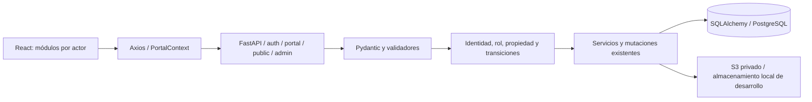

# Auditoría previa — Enlaces Institucionales ITS

## Alcance y estado de trabajo

Paso 1 del encargo completo recibido. Auditoría de código y maqueta aislada, sin implementar las fases A–F ni modificar rutas, contratos, modelos, permisos, esquemas o producción. Requiere confirmación del usuario antes de implementar, conforme a la sección 16 del prompt.

Repositorio: `Kike1196/Incubadora_tec`. Worktree: `C:/proyectos/IncubadoraEnLinea/incubadora-tec-audit`. Rama local: `feat/enlaces-institucionales-its`, basada en `ea230d7`, que contiene la auditoría anterior. Los assets de marca preparados antes del prompt completo siguen sin commit. Este reporte tampoco se ha publicado ni desplegado.

La inspección cubrió rutas React, navegación por actor, componentes, CSS, DTOs Pydantic, routers, servicios, mutaciones, modelos, migraciones, configuración, documentos y pruebas existentes. «Falta» significa que no se encontró implementación en esas capas; no se deduce la existencia de una función por su nombre o texto de pantalla.

## a. Arquitectura actual

### Stack y recorrido de datos

- Frontend: JavaScript/JSX, React 18, React Router 6, Vite 5, Axios, Tailwind 3 y CSS convencional; npm con lockfile. Sin TypeScript.
- Backend: Python 3.11, FastAPI 0.116.2, Pydantic 2.9.2, SQLAlchemy 2.0.35, Alembic 1.13.3; pip/requirements.txt. PostgreSQL 15. ReportLab, WeasyPrint y Pillow ya disponibles.
- Autenticación: JWT Bearer en localStorage; bcrypt y `auth_version`. El servidor obtiene identidad y rol desde la BD. Roles técnicos: `admin`, `estudiante`, `externo`; etiquetas: Coordinador, Emprendedor, Externo.
- Producción existente: Docker linux/amd64, ECS/Fargate Express Gateway, ECR, RDS PostgreSQL privado, S3 privado, Secrets Manager y HTTPS; frontend y `/api` en el mismo origen. No se consultó ni modificó AWS para este Paso 1.

Puntos de entrada: `frontend/src/App.jsx`, `frontend/src/shared/api/client.js`, `frontend/src/shared/portal/PortalContext.jsx`, `backend/app/main.py`, `backend/app/production.py`. La API del portal utiliza `/portal/state` y `PUT /portal/{collection}/{UUID}` con esquemas y handlers por colección, además de operaciones específicas de documentos, asistencia, integrantes y revisiones. No deben sustituirse por una API nueva.

### Módulos y rutas actuales

| Área | Rutas y componentes actuales | Backend/persistencia |
| --- | --- | --- |
| Público | `/`, `Landing.jsx`, `Newsletter.jsx`; `/login`, `/registro` | `/auth/login`, `/auth/registro`, `/public/newsletter`, imágenes públicas autorizadas por publicación/evento |
| Coordinador | `/coordinador/inicio`, `boletin`, `usuarios`, `roles`, `eventos`, `publicaciones`, `pagos`, `reportes`, `tutorias`, `seguimiento`, `solicitudes`, `registros` | `modules/coordinacion`, `modules/compartido`; rol técnico admin |
| Emprendedor | `/emprendedor/inicio`, `boletin`, `proyectos`, `avances`, `eventos`, `tutorias`, `pagos`, `inscripciones` | `modules/estudiantes`, handlers compartidos; propiedad/integrantes |
| Externo | `/externo/inicio`, `boletin`, `eventos`, `solicitud`, `pagos`, `inscripciones` | `modules/externos`; admisión convierte a estudiante y crea proyecto |
| Innovación | `/innovatecnm/inicio`, `certamen`, `hackatec`, `innobotica`, `innovaccion`, `retos`, `registros` | `Innovacion`, JSON, revisión/etapas/historial; admin y estudiante, no externo |
| Subrutas operativas | Proyectos nuevo/detalle/editar; eventos nuevo/editar/checkout/tipos/inscripciones; reportes proyectos/emprendedores/avances/estadisticas; tutorías agenda/historial/disponibilidad/agendar | Se preservan todas, incluidos enlaces con query y descargas |
| Utilitarias | 404 de React; redirección a login o inicio del rol cuando falta acceso | No hay página 403, contacto funcional ni aviso de privacidad |

Las familias `/incubadora`, `/innovatec`, `/vinculacion`, `/eventos` públicas independientes, `/encuestas`, `/difusion` y `/admin` de frontend no están declaradas en `App.jsx`. Que el servidor SPA devuelva index.html no significa que esas rutas sean funcionales: React muestra el fallback. `/admin/publications` sí existe como endpoint, no como página `/admin`.

### Menús efectivos, orden exacto

`PortalLayout.jsx` inserta Boletín y renombra únicamente la etiqueta de publicaciones a Gestionar noticias. Debe auditarse el resultado, no solo el array navigation.js.

- Emprendedor: Inicio, Boletín, Proyectos, Mis avances, Eventos, Tutorías, Mis pagos, Mis inscripciones, InnovaTecNM.
- Coordinador: Inicio, Boletín, Usuarios, Roles, Eventos, Gestionar noticias, Pagos, Reportes, Tutorías, Seguimiento, Solicitudes, Registros, InnovaTecNM.
- Externo: Inicio, Boletín, Eventos, Solicitar ingreso, Mis pagos, Mis inscripciones; sin enlace Innovación.

**Diferencia crítica:** «InnovaTecNM ↗» es un `Link` interno a `/innovatecnm/inicio`, en la misma pestaña; no tiene URL externa ni target. No se puede conservar el comportamiento existente y simultáneamente anunciar que abre un sitio externo. Se propone conservar destino y comportamiento hasta recibir la URL oficial y una decisión explícita.

### Modelo actual: 18 tablas

`usuarios`, `proyectos`, `integrantes_proyecto`, `documentos`, `historial_estatus`, `avances`, `tareas`, `tipos_evento`, `eventos`, `inscripciones`, `pagos`, `horarios`, `tutorias`, `solicitudes`, `innovacion`, `registros_iniciales`, `publicaciones`, `imagenes_editoriales`.

Fuentes: `backend/app/models/{usuario,proyecto,seguimiento,portal,publication,editorial_image}.py`. Última migración existente: `3a608b5c8533`. Proyecto enlaza registro y solicitud; documentos e integrantes son por proyecto; eventos tienen inscripciones, asistencia y constancias; `RegistroInicial` guarda datos/administración/anexos/historial JSON; `Innovacion` guarda propuesta e historial JSON, con asesor/líder como texto, sin entidad de equipo ni integrantes estructurados.

Estados actuales de proyecto: Pendiente, En revisión, En proceso, En incubación, Completado. No equivalen a activo/en seguimiento/pausado/concluido/formalizado. Innovación distingue estado de revisión y etapa Local/Regional/Nacional, tampoco la nueva máquina de estados de equipo. No se reemplazarán esos valores históricos.

### Ejecución y comprobaciones

- Frontend: `npm ci`, `npm run dev`, `npm test`, `npm run build` desde frontend.
- Backend: entorno virtual, `pip install -r requirements.txt`, `alembic upgrade head`, `uvicorn app.main:app --reload`; configurar variables mediante `.env.example`, sin modificar `.env` automáticamente.
- Entorno completo: `docker compose up -d --build`. La semilla demo es opcional; no ejecutarla en producción para probar el rediseño.
- Backend tests: `python -m unittest discover -s tests -v` con PostgreSQL aislado; navegador: `npm run test:browser` con portal local aislado.
- No hay comandos configurados de lint, formatter, typecheck ni Lighthouse. No se afirma que pasaron herramientas inexistentes. Sus incorporaciones se justificarán antes de agregar dependencias.

## b. Matriz de funcionalidades, secciones 7–13

Existe = implementado para el comportamiento señalado; Parcial = hay base reutilizable, pero falta parte del requisito; Falta = no hay implementación. Esfuerzo aproximado en jornadas efectivas de 8 horas de una persona full-stack, incluyendo pruebas de la función; no son tiempos de entrega ni deben sumarse mecánicamente, porque hay reutilización y dependencias. Los archivos citados existen; los archivos propuestos se enumeran después.

### 7. Público y acceso

| Requisito | Estado | Evidencia actual / diferencia | Esfuerzo |
| --- | --- | --- | --- |
| Hero con marca completa, lema y CTA | Parcial | `modules/publico/Landing.jsx`: hero y CTA, marca anterior; assets nuevos preparados pero no usados | 0.5–1 |
| Dos tarjetas públicas Incubadora/InnovaTec | Parcial | `Landing.jsx`: cuatro servicios, no las dos entradas ni páginas principales requeridas | 0.5–1 |
| Cuatro pilares enlazados e iconografía | Falta | Sin franja equivalente en Landing | 0.5–1 |
| Estrategia y cinco ejes | Falta | Sin contenido de estrategia ni módulo | 0.5–1 |
| Cierre «¡Tu idea, nuestro apoyo!» | Falta | CTA con otro texto | 0.25 |
| Próximos eventos y noticias reales | Existe | `Newsletter.jsx`, `newsletter.py`: publicaciones vigentes y eventos futuros de BD; la nueva distribución visual y multimedia es extensión | 0.5–1 |
| Accesos registro/Innovatec/encuesta | Parcial | Registro/login existen; inscripción pública Innovatec y encuestas faltan | 0.5–1 más B/D |
| Login con marca completa, sin cambiar auth | Parcial | `Login.jsx`, `auth/routes.py`: login funcional, identidad antigua | 0.5–1 |
| Pie, redes y contactos con marcadores | Parcial | `Landing.jsx`, `PortalLayout.jsx`: pie básico; faltan redes/datos confirmados | 0.5–1 |

### 8. InnovaTec

| Requisito | Estado | Evidencia actual / diferencia | Esfuerzo |
| --- | --- | --- | --- |
| 8.1 Proceso de 11 pasos y bifurcación | Parcial | `Innovation.jsx`: solo tres etapas y catálogo; no stepper de 11 pasos | 1–2 |
| 8.2 Convocatoria anual, manual, versión y fechas | Parcial | `Publications.jsx`, `newsletter.py` admiten categoría Convocatoria; no gestión de manual/versiones/etapas | 2–4 |
| 8.3 Equipo, integrantes, carrera/semestre, privacidad y folio | Parcial | `Innovation.jsx`, `InnovationInput`: nombre/equipo/líder/asesor/descr./categoría; sin integrantes estructurados, consentimiento o folio de equipo. Folios de registro inicial reutilizables como patrón, no misma serie automática | 3–5 |
| 8.4 Documentación requerida configurable por equipo | Parcial | `Documents.jsx`, `documents.py` revisan documentos de proyectos; no equipos ni lista de requisitos | 2–4 |
| 8.5 Ocho estados de equipo y cambios válidos | Parcial | `save_innovation` valida borrador/revisión/resolución y avance de etapa; faltan estados operativos de equipo | 2–3 |
| 8.6 Etapa local: calendario, sede, jurado, resultados | Parcial | `Evento` tiene fecha/hora; no sede ni jurado/resultados de equipo | 2–3 |
| 8.7 Logística regional/nacional y checklist | Parcial | Etapas en `Innovacion.datos`; sin logística, responsables ni checklist | 2–3 |
| 8.8 Diplomas participantes/asesores y entrega | Parcial | `event_certificates.py` genera constancias por asistencia; no diploma por equipo, asesor o estado de entrega | 1.5–3 |
| 8.9 Pláticas alumnos/docentes, sesiones y asistencia | Parcial | Eventos/inscripciones/asistencia existen; faltan contenido, clasificación y relación con convocatoria | 1.5–3 |
| 8.10 Diagrama diagnóstico → continuidad | Falta | No componente ni contenido relacionado | 0.5–1 |
| 8.11 Canalizar equipo a Incubadora sin duplicar registro | Falta | No FK/relación Innovacion–Proyecto ni operación atómica/idempotente | 2–4 |
| 8.12 Listado, actualización, historial y filtros | Parcial | `Innovation.jsx`: listado, búsqueda, estado, edición, historial y CSV; faltan año, etapa como filtro y expediente de equipo | 1–2 |
| 8.13 Enlace externo conservado | Parcial | `PortalLayout.jsx`: destino realmente interno `/innovatecnm/inicio`; URL externa ausente | 0.25 tras decisión |

### 9. Incubadora

| Requisito | Estado | Evidencia actual / diferencia | Esfuerzo |
| --- | --- | --- | --- |
| 9.1 Canal de llegada y registro público de proyecto | Parcial | `Registro.jsx`, `ProjectForm.jsx`, `Application.jsx`: alta cuenta y registro tras login; no captación pública de proyecto ni canal | 2–4 |
| 9.2 Contacto/tipo/carrera/semestre | Parcial | Usuario tiene nombre/correo/especialidad; FullRegistration tiene datos de socios, pero no el nuevo diagnóstico estructurado | 1–2 |
| 9.2 Perfil, etapa, necesidad, pausa y preferencias | Parcial | `FullRegistration.jsx`/JSON cubre formato anterior; faltan los catálogos y campos definidos para el nuevo diagnóstico | 2–4 |
| 9.2 Privacidad y PDF de nuevo registro | Parcial | `DownloadRegistration.jsx`/`registration_word.py` exporta Word aprobado; ReportLab/WeasyPrint disponibles. Falta PDF nuevo con marca/consentimiento | 1–2 |
| 9.3 Asesor, primer contacto y notificación | Falta | Sin asesor_id, perfil asesor o bandeja de notificaciones persistentes. `notify()` solo es aviso de la sesión actual | 2–3 |
| 9.4 Expediente único completo | Parcial | `Projects.jsx`: propietario, integrantes, registro, documentos, tareas, avances, estatus/comentario. Faltan diagnóstico, asesor, atenciones, cierre y enlace equipo | 2–4 |
| 9.5 Bitácora y tres datos obligatorios | Parcial | «Bitácora de avances» es tabla `Avance(hito,notas,fecha)`; no atenciones ni responsable/actividad/fecha_revision obligatorios | 3–5 |
| 9.6 Identificar/Atender/Acordar/Seguimiento | Falta | Sin flujo de cuatro pasos | 1–2 |
| 9.7 Periodicidad, próxima revisión y vencidos | Falta | No fechas de revisión ni programación. No SMTP/cola de correo implementados | 2–4 |
| 9.8 Hitos comunes administrables y por proyecto | Parcial | Avances libres y tareas existen; no catálogo de hitos, orden, etapa, estado por proyecto ni evidencia asociada | 2–3 |
| 9.9 Inactivos configurables y reactivación | Falta | Sin umbral, pausa o atención de recuperación | 1.5–3 |
| 9.10 Cierre/pausa con motivo, fecha y transiciones | Parcial | `HistorialEstatus` registra cambios; estados antiguos no cubren nueva operación ni reglas de cierre | 2–3 |
| 9.11 Catálogo: 4 etapas, 12 servicios y 3 niveles | Falta | Catálogos actuales son especialidades/eventos/innovación, no servicios de incubación | 2–3 |
| 9.12 Canalización especializada y resultado | Falta | Sin entidad ni formulario de canalización por atención | 1–2 |
| 9.13 Indicadores y CSV por periodo/perfil/etapa | Parcial | `Reports.jsx`: usuarios/proyectos/avances/progreso/especialidad/estatus y CSV; faltan nuevos datos y filtros temporales | 2–4 |

### 10. Encuestas

| Requisito | Estado | Evidencia actual / diferencia | Esfuerzo |
| --- | --- | --- | --- |
| Constructor, públicos, 4 tipos, obligatoriedad, fechas | Falta | No componentes, schemas, endpoints ni tablas de encuestas | 3–5 |
| Respuesta pública anónima/identificada y duplicados | Falta | Sin mecanismo de respuestas o identidad anónima | 2–4 |
| Tres plantillas editables | Falta | Datos del prompt no existen como plantilla de encuesta | 0.5–1 |
| Resultados, porcentajes, barras/dona, conteo y CSV | Falta | `Reports.jsx` tiene barras simples de proyectos; sin agregación de encuestas | 2–3 |
| Diagnóstico de 25 respuestas como referencia separada | Falta | No existe contenido de referencia; nunca se debe cargar como 25 respuestas reales | 0.5–1 |
| Hallazgos alumnos/docentes y necesidades detectadas | Falta | Sin contenidos del diagnóstico en el sitio | 0.5–1 |

### 11. Difusión

| Requisito | Estado | Evidencia actual / diferencia | Esfuerzo |
| --- | --- | --- | --- |
| Centralizar información/convocatorias/registro | Parcial | Landing + Boletín + portales; falta integración de nuevas secciones | 0.5–1 |
| Piezas por canal, calendario, responsable, estado/enlace | Falta | Publicación es noticia, no pieza de difusión por canal | 2–3 |
| Visitas a salones y resultados | Falta | Sin entidad ni captura | 1–2 |
| Plantillas y registro de envíos alumnos/docentes | Falta | Sin plantillas o mecanismo de envío; registrar envío manual no equivale a envío real | 1–2 |
| Orientación y FAQ administrable | Parcial | Textos informativos en Landing/Innovation, no páginas completas ni FAQ administrable | 1–2 |
| Multimedia/reels/videos/experiencias | Parcial | `EditorialImages.jsx` + `editorial_media.py` tienen galería de imágenes; no videos/reels ni piezas | 1–2 |
| Noticias/Gestionar noticias/Boletín integrados | Existe | `Publications.jsx`, `Newsletter.jsx`, `Publication`; extender relaciones sin nueva tabla de noticias | 0.5–1 para vincular difusión |
| Compartir WhatsApp y redes | Falta | Solo enlace público de noticia, sin enlaces sociales provistos | 0.5–1 |
| Flujo visible publicación → participación → continuidad | Parcial | Registro y participación existen separadamente; falta exposición del flujo y vínculos nuevos | 0.5–1 |

### 12–13. Eventos, vinculación y permisos

| Requisito | Estado | Evidencia actual / diferencia | Esfuerzo |
| --- | --- | --- | --- |
| Listado/detalle público, fecha/lugar/galería | Parcial | `Newsletter.jsx` muestra futuros; `Events.jsx` es autenticado. Sin detalle público ni campo sede | 1–2 |
| Inscripción, asistencia y constancias de eventos | Existe | `EventManagement.jsx`, `Registrations.jsx`, `routes.py`, `event_certificates.py`; conservar pagos | 0.5–1 para relaciones nuevas |
| Tres eventos indicados con datos desconocidos visibles | Falta | No se asume que existen en producción por un seed/demo. Fecha no admite texto «Por definir» en Evento | 0.5–1 más metadatos de borrador |
| Vinculación y contacto institucional | Falta | Landing tiene footer informativo, no página ni recepción persistente de contactos | 1–2 |
| Público consulta/catálogo/encuesta/registro equipo-proyecto | Parcial | Consulta Boletín y registro de cuenta; nuevas capacidades faltan | 1–2 transversal |
| Emprendedor, Coordinador y Externo con permisos backend | Existe | `RutaProtegida.jsx`, `security.py`, `services.py`, mutaciones por actor | 1–2 regresión |
| Asesor con expedientes asignados | Falta | Rol técnico y asignación no existen | 2–3 |
| Administrador separado del coordinador | Parcial | Admin técnico ya tiene gestión amplia y etiqueta Coordinador; no separación de perfiles | 1–3 tras decisión |
| Auditoría de cambios sensibles | Parcial | Historial de proyecto/registro/documento/innovación y asistencia; no auditoría general de usuarios/catálogos/publicaciones/encuestas | 2–3 |
| Nuevos menús protegidos por rol/propiedad | Falta | No hay módulos nuevos ni permisos asociados | 1–2 transversal |

## c. Las 14 tarjetas y su equivalencia real

Todas se renderizan en `frontend/src/shared/portal/Home.jsx` mediante `modules.map` y `Link`. Se enumeran según el prompt; en el código, la tarjeta número 10 aparece primero. «Sí» compara destino normal de tarjeta y menú; en preview ambos agregan `/vista-previa`, sin cambiar la equivalencia.

| Perfil / tarjeta | Ruta de la tarjeta | Opción efectiva del menú / ruta | ¿Misma ruta? | Riesgo huérfano |
| --- | --- | --- | --- | --- |
| Coordinador 01 Usuarios | `/coordinador/usuarios` | Usuarios → `/coordinador/usuarios` | Sí | Bajo |
| Coordinador 02 Roles | `/coordinador/roles` | Roles → `/coordinador/roles` | Sí | Bajo |
| Coordinador 03 Eventos | `/coordinador/eventos` | Eventos → `/coordinador/eventos` | Sí | Bajo |
| Coordinador 04 Reportes | `/coordinador/reportes` | Reportes → `/coordinador/reportes` | Sí | Bajo |
| Coordinador 05 Tutorías | `/coordinador/tutorias` | Tutorías → `/coordinador/tutorias` | Sí | Bajo |
| Coordinador 06 Seguimiento | `/coordinador/seguimiento` | Seguimiento → `/coordinador/seguimiento` | Sí | Bajo |
| Coordinador 07 Pagos | `/coordinador/pagos` | Pagos → `/coordinador/pagos` | Sí | Bajo; módulo fuera de alcance |
| Coordinador 08 Solicitudes | `/coordinador/solicitudes` | Solicitudes → `/coordinador/solicitudes` | Sí | Bajo |
| Coordinador 09 Registros | `/coordinador/registros` | Registros → `/coordinador/registros` | Sí | Bajo |
| Coordinador 10 Boletín | `/coordinador/publicaciones` | **Gestionar noticias** → `/coordinador/publicaciones` | Sí con Gestionar noticias; **no** con Boletín → `/coordinador/boletin` | Bajo si se mantienen ambas opciones |
| Emprendedor 01 Mis proyectos | `/emprendedor/proyectos` | **Proyectos** → `/emprendedor/proyectos` | Sí; solo difiere la etiqueta | Bajo |
| Emprendedor 02 Mis avances | `/emprendedor/avances` | Mis avances → `/emprendedor/avances` | Sí | Bajo |
| Emprendedor 03 Eventos | `/emprendedor/eventos` | Eventos → `/emprendedor/eventos` | Sí | Bajo |
| Emprendedor 04 Tutorías | `/emprendedor/tutorias` | Tutorías → `/emprendedor/tutorias` | Sí | Bajo |

Estilos implicados: `.module-grid`, `.module-card`, `.module-card:hover`, `.module-number`, `.module-card h2`, `.module-card p`, `.module-arrow`, sus media queries 1050/700 px y reduced-motion en `shared/portal/portal.css`. **No son exclusivos:** también los usa `Innovation.jsx` y la rama externa de `Home.jsx`. En A se elimina el render/listado/numeración únicamente para admin y estudiante; se conservan los estilos mientras tengan esos otros consumidores. No se borran archivos.

La bienvenida también debe retirar, para esos dos perfiles, Stats, Newsletter compacto, panel de proyecto/agenda y sus enlaces actuales del cuerpo de Home. Eliminación de presentación expresamente requerida por 6-bis.2, sin perder datos ni los módulos accesibles por menú. El botón general «Actualizar datos» no es acceso a módulos; permanece si sigue siendo necesario. El perfil externo no está incluido en esta eliminación.

Regresión exigida en A: rutas directas antiguas funcionales; comparar orden/etiqueta/destino del nav por rol; ausencia de `module-grid` y enlaces de módulos en el cuerpo de ambas bienvenidas; conservación de pagos/inscripciones, enlaces de noticias y rutas InnovaTec; backend 401/403 y propiedad sin cambios. Las pruebas actuales esperan títulos antiguos y Boletín antes del hero: se actualizarán solo esas expectativas visuales, no las de permisos o contratos.

## d. Recorte y vista previa del lockup

- Original 1254 × 1254 px; copia original verificada por SHA-256. Variantes completas WebP/JPEG 1200/800/400 ya preparadas sin integración.
- Recorte exacto PNG: caja `(280, 220, 1010, 676)` en coordenadas del original, origen superior izquierdo y extremos derechos/inferiores exclusivos: **730 × 456 px**. Conserva el símbolo central completo; no incluye texto ENLACES ni los escudos.
- A 48 px de alto: 77 × 48 px (1×), 154 × 96 (2×), 231 × 144 (3×). A 40 px móvil: 64 × 40, 128 × 80 y 192 × 120. Todas son reducciones, ninguna ampliación. La inspección visual no muestra pixelación; detalles internos son pequeños pero el símbolo es reconocible.
- Decisión propuesta: **usar el recorte exacto**, sin recreación SVG, recolor, transparencia artificial, sombras ni filtros. No se necesita solicitar vector para las dimensiones previstas. La institución puede sustituirlo después por un horizontal oficial si lo entrega.
- Colores representativos obtenidos mediante máscara y frecuencia RGB cuantizada a pasos de 8: guinda `#700020` (gradiente, también #680020/#600020), plata `#909090`, azul oscuro cercano a `#183050`; fondo mayoritario #F8F8F8 con matices cálidos. No se interpreta el gradiente como un único color oficial. Propuesta de UI: guinda #700020, plata solo para elementos secundarios decorativos, texto #2B2B2E y gris de lectura más oscuro, fondo #F7F5F2. Confirmar contraste AA al implementar; no se recolorea el activo.
- Maqueta de auditoría: `../.local/auditoria-enlaces/lockup-preview.html`. Captura: `../.local/auditoria-enlaces/lockup-preview.png`. Recorte: `../.local/auditoria-enlaces/monograma-exacto.png`. No son código del sitio ni assets ya integrados.
- Chrome verificó barras de **72/56 px**, imágenes de **48/40 px**, marco móvil de **320 px**, imágenes completas y cero excepciones JS. Texto de marca es HTML real. La maqueta usa tipografías fallback existentes y navegación de muestra, no todos los módulos funcionales.

**Ambigüedad bloqueante de identidad:** el margen libre de un ancho del monograma alrededor de la imagen no cabe verticalmente en 72 px con un símbolo de 48 px ni en 56 px con símbolo de 40 px. La vista previa propone 12/8 px verticales y separación compacta imagen/texto, pendiente de aceptación como excepción exclusiva del encabezado. Para la imagen completa se reservará espacio proporcional y se reducirá su tamaño en móvil; «420 px» es máximo, no mínimo. También falta definir la medida institucional de «ancho del monograma» (E sola o símbolo central completo).

## e. Propuesta de submenús

Sin renombrar, reordenar ni cambiar destino de las opciones existentes. Cada opción que gane submenú conserva un enlace directo original y añade un botón separado de despliegue; no convertirla únicamente en botón ni abrir menús por hover exclusivamente.

| Perfil / opción | Subopciones propuestas | Destino/base reutilizado |
| --- | --- | --- |
| Coordinador — Seguimiento | Proyectos (enlace actual), Seguimientos de la semana, Vencidos, Inactivos | `/coordinador/seguimiento` y subrutas nuevas |
| Coordinador — Reportes | Reportes actuales, Indicadores | `/coordinador/reportes` y subruta indicadores |
| Coordinador — Gestionar noticias | Noticias (enlace actual), Difusión: piezas/calendario, visitas, plantillas/envíos, multimedia/FAQ | Publicaciones existentes; `/coordinador/difusion/*` nuevas |
| Coordinador — Encuestas (nueva) | Gestión, Resultados | `/coordinador/encuestas/*` |
| Coordinador — Catálogo (nueva) | Servicios, Hitos | `/coordinador/catalogo/*` |
| Coordinador — Gestión InnovaTec (nueva) | Convocatoria/manual, Equipos, Pláticas, Diplomas, Seguimiento/logística | `/coordinador/innovatec/*` |
| Emprendedor — Proyectos | Listado actual y capacidades dentro del expediente, sin nuevo panel de accesos | Ruta actual; bitácora/hitos/revisión/servicios dentro del detalle |
| Emprendedor — Mis avances | Tareas/hitos y actividades de sus proyectos | Ruta actual |
| Emprendedor — Boletín | Contenido y enlaces de encuestas dentro de Boletín | Ruta actual; encuestas públicas |
| Emprendedor — Mis inscripciones | Eventos actuales y vistas pláticas/Innovatec vinculadas, sin modificar Pagos | Ruta actual, extensión de consulta |

Difusión se integra como submenú de Gestionar noticias, identificada explícitamente como Difusión, para evitar otra opción principal. Las nuevas opciones de coordinador se agregan después de Registros, manteniendo el enlace InnovaTecNM al extremo derecho con su destino vigente. Si se requiere Difusión de primer nivel, confirmar antes de implementarla. El menú público será Inicio/Incubadora/InnovaTec/Vinculación/Eventos/Contacto en el orden pedido.

Escritorio: franja fija 72 px + nav fijo, una línea con overflow horizontal; submenús en capa que no quede recortada por ese overflow. Móvil: franja 56 px y botón hamburguesa; dentro del menú, identidad de usuario, cierre de sesión y todas las opciones. `aria-expanded`, relación botón-panel, Escape, devolución de foco, foco visible y operación por teclado. Preferir `nav`, botones y listas de enlaces; no imponer roles ARIA menu de aplicación sin implementar su navegación completa. `NavLink` ya provee aria-current; extender a padres/subrutas sin perderlo.

## f. Componentes de diseño

| Elemento | Existe | Acción propuesta |
| --- | --- | --- |
| Marca | `InstitutionalBrand.jsx`, index.css, PNG ITS/TecNM separados | Sustituir visual del encabezado por lockup; componente de imagen completa para hero/login/bienvenida/pie/OG; conservar archivos viejos sin borrarlos |
| Layout y navegación | `PortalLayout.jsx`, Landing, arrays navigation, Links/NavLink | Extender con dos franjas sticky/fijas, menú móvil y submenús; no tocar logout ni permisos |
| Tokens | root de portal.css, colores/fuentes duplicados en Tailwind/landing/newsletter/editorial/index | Crear `shared/design/tokens.css` como fuente única; alias CSS para nombres legacy y Tailwind referenciado a variables |
| Tipografía | Cambria/Georgia/Calibri/Segoe UI; sin fuentes descargadas | Propuesta Cormorant Garamond + Montserrat autoalojadas, licencias y font-display swap; fallback actual. No paquetes npm de fuentes |
| Botones/paneles/estados | `ui.jsx`: Heading, Panel, Badge, Progress, Empty, Stats | Reutilizar firmas; aplicar tokens, contraste y etiquetas de estado |
| Formularios/archivos | Field, TextArea, Form, FullRegistration, Documents, ImageEditor | Extender multiselección/ayuda/errores en línea manteniendo validación/doble envío/drafts |
| Modales | dialog nativo de `Modal` | Reutilizar, verificar teclado/foco y cabecera fija |
| Tablas/filtros/CSV | Table, filtros locales, exportCSV seguro | Reutilizar; añadir orden accesible y filtros de periodo en pantallas que lo necesiten |
| Tabs/acordeones | botones con aria-pressed; details en expediente | Unificar y completar semántica/teclado; no quitar comportamiento |
| Iconos | caracteres/flechas/señales dispersas | Conjunto de iconos lineales genéricos; nunca recrear logos oficiales en SVG |
| Stepper/timeline/migas | etapa textual y tablas de historial, sin componente completo | Crear componentes pequeños para los flujos requeridos |
| Gráficas | meter en Reports | Reutilizar barras; dona accesible con tabla/texto equivalente, sin nueva librería |
| Carga | texto Cargando/estados locales | Skeletons accesibles y reintento conservando datos |
| SEO/privacidad | title/description únicos en index.html; 404; sin OG/robots/sitemap/403/privacy | Crear metadata por página y documentos públicos aprobados; noindex en privadas |

Espaciado propuesto: 8/16/24/32/48/64, controles con área táctil suficiente, radios 4/8/12 y sombras leves solo en superficies, nunca en el logo. Breakpoints propuestos 480/768/1024 px, con comprobación desde 320 px. Mantener solo modo claro y ampliar prefers-reduced-motion a componentes nuevos.

## g. Riesgos y mitigaciones

| Riesgo | Mitigación prevista |
| --- | --- |
| Pérdida de accesos al retirar Home | Matriz de 14 equivalencias, tests por perfil, conservar nav y rutas; bienvenida sin resúmenes/enlaces de módulos |
| Boletín de gestión confundido con lectura | Conservar `/publicaciones` como Gestionar noticias y `/boletin` como consulta |
| CSS compartido eliminado o tokens que afectan formularios | No borrar selectores con consumidores; aliases legacy; regresión móvil de formularios/modales/tablas |
| Header fijo oculta contenido, anclas o foco | Contenedor único fijo/sticky, compensación de altura y scroll-margin, prueba teclado/zoom/320 px |
| Menú con overflow recorta submenús | Panel de despliegue fuera del contenedor con overflow; anclaje/foco/teclado verificados |
| Cambio accidental de estados o significado histórico | Campos complementarios 1:1 para operación nueva; estados anteriores y JSON originales intactos |
| Diagnóstico nuevo invalida registros históricos | Nuevas reglas solo para nuevo diagnóstico; Word previo permanece disponible; sin recaptura obligatoria automática |
| Duplicación equipo/proyecto o canalización repetida | Relación única, transacción/lock, idempotencia y bitácora en ambos lados; sin crear cuentas ni asignar asesor por coincidencia de nombre |
| Asesor adquiere permisos globales de admin | Perfil/capacidad nueva y acceso por asignación; require_admin legacy se mantiene; negativos 403/IDOR en cada endpoint nuevo |
| Registro público expone datos privados | Intake separado/DTO explícito, control de abuso, acceso posterior autenticado o token limitado definido; nunca expediente público por UUID |
| Encuestas anónimas prometen unicidad imposible | Identificado: UNIQUE por usuario/encuesta. Anónimo: token/cookie limitado evita reenvío del navegador, no garantiza persona única; sin fingerprint invasivo |
| Cifras del diagnóstico contaminan indicadores | Referencia informativa etiquetada y separada de respuestas reales; denominadores explicitados en multiselección |
| Recordatorios/envíos simulados como reales | Sin SMTP actual: fechas/avisos persistentes en pantalla; envío manual registrado como tal; correo pendiente de decisión |
| Videos/enlaces maliciosos, archivos públicos indebidos | URLs http(s) validadas, sin HTML/embed arbitrario; validar contenido/tamaño, storage existente y autorización; no inventar hospedaje de video |
| Rollback elimina información capturada en tablas nuevas | Reversión de aplicación mantiene tablas; downgrade de esquema solo sobre entorno vacío o exportación/restauración revisada. Ningún downgrade destructivo automático |
| SEO de SPA no visible al crawler social | Etiquetas de documento público servidas por backend por ruta/canonical, mismo SPA; no depender solo de cambios JS para OG ni cambiar framework |
| Privacidad/legalidad presentada como certificada | Aviso oficial validado por institución; consentimiento versionado, minimización y controles; sin inventar responsable/plazos/base legal |

Deuda existente a reportar sin cambios en Paso 1: enlace externo realmente interno; estilos duplicados; tests StaticRouter muestran warnings Navigate (pasan); configuración Docker local incluye valores de demostración estáticos que no deben reutilizarse en producción; no SMTP; no lint/formatter/Lighthouse configurados. Los avisos previos de Router y bibliotecas del contenedor permanecen en `AUDITORIA_FORMULARIOS.md`/`VERIFICACION_AUDITORIA.md`; esta auditoría no es un escaneo nuevo de producción.

## h. Plan de migraciones aditivas y reversión

**Propuesta, no ejecutada.** Preferir nuevas tablas relacionadas 1:1 o 1:N para conservar clases/columnas/estados/contratos existentes. Nombres finales se ajustarán al esquema antes de cada migración. FK e índices en relaciones y filtros, CHECKs de enums/rangos/fechas, UNIQUE donde aplique; bajas lógicas para catálogos usados y RESTRICT donde borrar destruya trazabilidad. No añadir campos obligatorios sin defaults a filas existentes.

| Migración/fase | Adiciones propuestas y reutilización | Reversión segura |
| --- | --- | --- |
| B1 Base InnovaTec | Convocatoria, versión/manual/archivos/fechas/requisitos; ficha de equipo 1:1 con Innovacion, integrantes, estado operativo/historial. Nombre/descr./propuesta originales siguen en Innovacion | Desactivar vistas nuevas y volver a imagen anterior; tablas quedan. Downgrade solo vacío; JSON legacy intacto |
| B2 Operación InnovaTec | Documentación por equipo usando validación/storage actuales; agenda/resultados/logística/checklist; diplomas por participante/asesor. Pláticas referencian Evento e Inscripcion, sin duplicar asistentes/eventos | Revertir app; tablas nuevas conservadas; no borrar objetos S3 o inscripciones existentes |
| C1 Diagnóstico/servicios | Contacto/perfil complementario, diagnóstico 1:1 del registro/proyecto, necesidades; catálogo servicios/hitos y configuración; estado operativo complementario de proyecto, asignación asesor, referencia origen InnovaTec única | No modificar Proyecto.estatus ni RegistroInicial.datos antiguos. Retirar nueva lectura/escritura conservando tablas |
| C2 Atención y seguimiento | Atenciones, evidencias, canalizaciones, hitos por proyecto, responsable/actividad/revisión obligatorios; vínculos opcionales a Avance/Tarea existentes; preferencias/inactividad/pausa/cierre/historial; próxima revisión derivada o persistida transaccionalmente | App legacy sigue usando Avance/Tarea/HistorialEstatus. Conservar nuevas bitácoras; downgrade vacío/exportado únicamente |
| D Encuestas | Encuestas, versiones/preguntas/opciones, respuesta e ítems, identidad anónima limitada, unicidad de identificadas; restricciones de ventanas y respuestas por tipo | No revertir eliminando respuestas; exportar y conservar tablas. Referencia de diagnóstico no se inserta como respuesta |
| E Difusión/eventos/contacto | Piezas, visitas, plantillas/envíos manuales, FAQ, contactos; enlaces a Publication y Evento. Metadatos de eventos/sede/tipo borrador anunciado sin fecha confirmada | Mantener publicaciones/eventos legacy; bajas lógicas, no eliminar inscripción/pago; contactos sujetos al plazo institucional pendiente |
| F Permisos/auditoría | Perfiles/capacidades complementarios de usuarios, asignaciones y auditoría general. Base mínima de auditoría/acceso incorporada antes si B/C la requiere | Revocar capacidades nuevas, preservar rol técnico/claims legacy y registros de auditoría; no modificar enum PostgreSQL de forma irreversible |

«Reversible» significa que existe downgrade definido sobre tablas nuevas y un plan de volver a la versión anterior; no significa que sea aceptable borrar datos capturados. En producción, preferir reversión de código sin downgrade. Respaldo, preflight y prueba de restauración preceden cualquier cambio de esquema real.

Los 12 servicios se precargan como propuesta con objetivo/resultado `[Por definir]`, sin inventar textos institucionales. Hitos propuestos sujetos a validación. Umbral de inactividad inicialmente no configurado: la interfaz lo solicita al administrador; no se presume N días. Sin asignación automática de María Emilia/Adriana Gómez a cuentas desconocidas.

## i. Fases, archivos y dependencias

El usuario pide un commit por funcionalidad en español y pruebas/build antes y después; no avanzar con checks en rojo. Estimación de alcance total: **aprox. 60–100 jornadas efectivas**, sujeta a decisiones de privacidad, roles y operación, disponibilidad de datos, revisión institucional y pruebas. No promete completar todo en una sola modificación. Los rangos por fase se solapan con trabajo transversal.

| Fase | Archivos actuales que se extenderían | Archivos nuevos propuestos | Dependencia y prueba de salida |
| --- | --- | --- | --- |
| A — 5–8 jornadas | InstitutionalBrand.jsx, App.jsx, Home.jsx, PortalLayout.jsx, ui.jsx, index.css, portal.css, landing.css, newsletter.css, editorial-images.css, Tailwind, Landing/Login/Registro, index.html, interface-checks.jsx | design/tokens.css; componentes marca completa/menú; fuentes y licencia; pruebas nav/bienvenida | Confirmación y excepción de margen. Sin migración. 14 destinos/orden/permisos intactos, no enlaces de módulos en bienvenida; 320/768/desktop; tests y build |
| B — 14–23 jornadas | Innovation.jsx/routes actuales, schemata/handlers innovación, documentos/storage, Events/Registrations, constancias | páginas público/gestión InnovaTec, schemas/models/routers complementarios, migraciones B1/B2 y tests | A; guardas existentes desde primer endpoint; equipo, documentos, estados, folio, logística, pláticas/diplomas. 8.11 completo depende de C1; no declarar B completo hasta comprobarlo |
| C — 16–26 jornadas | ProjectForm/FullRegistration/Application/RegistrationReview/Projects/Reports; handlers proyectos/solicitudes/registros, generadores de documentos | catálogo, diagnóstico, atenciones, seguimiento, inactivos, indicadores, schemas/routers/models/migraciones C1/C2; tests de reglas | A + vínculo B; nuevo diagnóstico sin romper Word previo; ninguna atención cerrada sin tres datos; cierre/reactivación y canalización idempotente |
| D — 8–13 jornadas | Boletín, menú, componentes gráficos/CSV/formularios y autorización existentes | módulo encuestas/público/admin, modelos/schemas/routers/migración/tests | A + reglas identidad/anonimato; roles protegidos desde D, no esperar F; resultados reales y duplicados probados |
| E — 8–14 jornadas | Publications/Newsletter/EventManagement/Events/EditorialImages y routers actuales | difusión, visitas, plantillas/envíos, FAQ, vinculación/contacto, detalle público, metadatos eventos | A + B/pláticas + C/captación + D/diagnóstico; no duplicar noticias/eventos/pagos, placeholders de fecha/sede no pasan por campos Date |
| F — 8–14 jornadas transversales | auth/security, guardas por actor, App/PortalLayout, production.py, README y tests | administración capacidades, auditoría, metadata pública, robots/sitemap, 403/privacidad/contacto, guía admin | Protecciones mínimas durante B–E; F completa matriz/performance/SEO. Lint/format justificados, pruebas completas, Lighthouse medido (objetivo ≥90, no resultado prometido) |

El contrato de rutas anteriores permanece. Las rutas pedidas nuevas se adaptan a las bases existentes para sesión y mantienen páginas públicas `/incubadora`, `/innovatec`, `/vinculacion`, `/eventos`, `/encuestas`, `/difusion`, `/contacto`, `/aviso-de-privacidad`; páginas admin propias se agregan protegidas. Si se exige una URL alias, definir redirección **HTTP 301/308** en producción, no llamar «permanente» a un Navigate de cliente. Bitácora/detalle privado exige auth aun si la URL usa base pública.

Decisiones transversales de seguridad, auditoría y estructura de datos se fijan antes de crear cada entidad/endpoint, aunque la revisión integral figure en F. La canalización 8.11 debe probarse después de C, por su dependencia real, o adelantar solo C1 con aceptación explícita de ese orden.

## j. Preguntas abiertas y marcadores

### Decisiones que condicionan la implementación

1. ¿Se acepta la excepción compacta de margen del encabezado de la vista previa (12/8 px verticales), conservando 72/56 y símbolo 48/40? Sin excepción, esas medidas y el despeje literal son incompatibles.
2. ¿Cuál es la URL externa oficial InnovaTecNM? Mientras falta, conservar `/innovatecnm/inicio` y su comportamiento interno. No inventar un destino ni anunciar falsamente una nueva pestaña.
3. ¿Se mantendrá admin técnico como Coordinador y se agregarán perfiles/capacidades para Administrador y Asesor? ¿Quién puede asignarlos y qué coordinadores pierden o conservan privilegios? Propuesta mínima: no retirar permisos legacy automáticamente; controles nuevos independientes.
4. ¿Qué significa «registro público» de proyecto/equipo: captura sin cuenta o formulario público que exige acceso para confirmar? Si es sin cuenta, definir recuperación/propiedad/verificación del contacto; no existe correo automático. No usar coincidencia de email sin verificación para entregar expedientes.
5. ¿Cuál es el aviso de privacidad institucional aprobado, responsable, versión, conservación y atención de derechos? ¿Qué datos del equipo serán públicos, si alguno?
6. ¿Se habilita canalización antes de un registro de ingreso aprobado, como flujo específico InnovaTec, o conserva el requisito actual de aprobación? Definir quién puede canalizar y acreditar potencial de negocio. Propuesta: coordinador autorizado y transacción única con diagnóstico por completar, sin reescribir registros existentes.
7. ¿Se acepta adaptar rutas privadas a `/coordinador/*` y `/emprendedor/*` según el prompt, manteniendo rutas públicas nuevas? ¿/admin será perfil complementario o alias del coordinador?
8. ¿Eliminación de cuadrículas solo de Home de los dos perfiles, como 6-bis, o también de inicio interno InnovaTec? Propuesta menos invasiva: solo Home; InnovaTec/Externo se conservan hasta una instrucción específica.
9. ¿Se acepta Difusión como submenú de Gestionar noticias y tres nuevas opciones principales (Encuestas, Catálogo, Gestión InnovaTec), conservando orden de las existentes?
10. ¿Reglas y calendario de próximas revisiones: días naturales o hábiles; horario y revisión mensual al mismo día con ajuste al último día válido? Propuesta: fecha local, 7/15 días naturales y mes calendario; revisar antes de formalizar reglas.
11. ¿Umbral N de inactividad, motivos estándar de pausa/cierre, criterios de concluido/formalizado y hitos propuestos aprobados? No escoger N automáticamente.
12. ¿Encuestas anónimas con limitación por navegador son suficientes o se requiere una invitación individual verificable? Aclarar denominadores y si las cifras de referencia se publican solo como diagnóstico histórico etiquetado.
13. ¿Fechas/sedes, convocatoria/manual vigente, categorías y lista de documentos obligatorios? No tratar el catálogo anterior como manual del año actual sin validación institucional.
14. ¿Diplomas oficiales con firma/sello autorizados o solo seguimiento/exportación? No extender una constancia de asistencia a diploma oficial sin autorización documental.
15. ¿Correo/notificación institucional disponible y política de envío? Propuesta mientras falta: próxima revisión y avisos en pantalla; no envíos simulados ni proveedor nuevo.

### Datos faltantes visibles

- `[Por definir: correo de contacto]`, `[Por definir: teléfono]`, `[Por definir: horario de atención]`, `[Por definir: contacto de Vinculación]`.
- `[Por definir: Instagram]`, `[Por definir: TikTok]`, `[Por definir: WhatsApp]`, `[Por definir: Facebook]`. Sin enlaces `#` presentados como enlaces sociales reales.
- `[Por definir: aviso de privacidad institucional aprobado]` y versión/responsable/plazo.
- `[Por definir: convocatoria y manual vigentes]`, categorías/requisitos/fechas/sedes/jurado/responsables/logística por etapa.
- `[Por definir: fecha y lugar del Día de Enlaces]`, `[Por definir: fecha y lugar de premiación InnovaTecNM 2026]`, `[Por definir: fecha y lugar de EmpoderaTec 2026]`. Lema EmpoderaTec confirmado en el prompt: «Si lo crees, lo creas».
- `[Por definir: objetivo]`, `[Por definir: resultado esperado]` y canalizaciones/organizaciones por servicio cuando falten; niveles y etapas sí provistos por el prompt.
- `[Por definir: hitos validados]`, umbral de inactividad y motivos de cierre/pausa; formato/documentación de diplomas; contenido específico de Vinculación.
- Cuentas reales de María Emilia y Adriana Gómez y sus permisos; no crear cuentas ni inventar correos a partir de esos nombres.

La dirección y enlace institucional que ya aparecen en Landing se preservan como contenido existente, sin afirmar una nueva verificación institucional. Los 25 resultados y porcentajes del prompt son referencia, no nueva captura ni indicadores reales. No se inventarán cohortes, fechas, números de asistentes, sedes ni resultados de concursos.

## Verificación de esta auditoría

- `npm test --prefix frontend`: aprobado; pruebas de agenda, drafts, teléfonos, bytes bcrypt/catálogos y render de 56 páginas/53 enlaces, límites de roles, documentos/Word y estados. Warnings existentes de Navigate con StaticRouter, sin fallo.
- `npm run build --prefix frontend`: aprobado; Vite compila 140 módulos. La compilación se hizo como línea base, no como prueba de funcionalidades futuras.
- Recorte/color/variantes: Pillow existente dentro del contenedor; sin instalar dependencias ni alterar el original.
- Maqueta: Chrome real, cero excepciones JS, barras 72/56 e imagen 48/40; revisión visual de recorte, densidades y composición escritorio/móvil.
- Pruebas previas de backend/Chrome/AWS se registran en `VERIFICACION_AUDITORIA.md`; no se repitieron contra producción para este Paso 1 y no demuestran los módulos todavía ausentes.
- No se ejecutaron migraciones, commits, push ni despliegue del rediseño. Se espera confirmación para Fase A y resolución de las decisiones bloqueantes.
